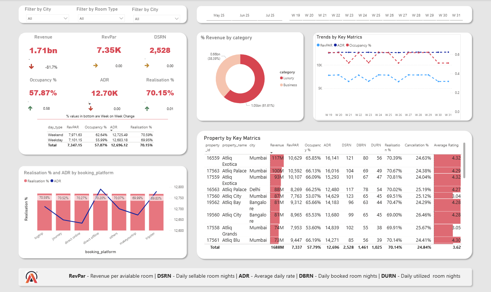

# AtliQ Grands hotel revenue

Across 25 hotels in four Indian cities, did weekends bring more revenue per available room through higher rates or fuller hotels? This Power BI case study compares bookings with available inventory for check-ins from 1 May to 31 July 2022.

[Power BI report](HotelProject.pbix) · [Presentation](Hospitality%20Revenue%20Analytics.pptx) · [Metric definitions and DAX](ExcelDatas/metrics-list.xlsx)



## Findings

| Check-in day group | Booked occupancy | Revenue per booking (ADR) | Revenue per available slot (RevPAR) | Checked out |
|---|---:|---:|---:|---:|
| Friday–Saturday | 62.64% | ₹12,725.49 | ₹7,971.63 | 70.59% |
| Sunday–Thursday | 55.99% | ₹12,683.18 | ₹7,101.15 | 69.95% |
| All | 57.87% | ₹12,696.12 | ₹7,347.15 | 70.15% |

The weekend gap in RevPAR was about ₹870. Occupancy rose by 6.65 percentage points while the rate per booking rose by about ₹42. A revenue analyst investigating the weekday gap could first compare occupancy for the same property and room class before proposing a price change.

The sample recorded ₹1,708,771,229 in realised revenue. Luxury properties accounted for 61.61% of it. Of 134,590 bookings, 94,411 checked out, 33,420 were cancelled and 6,759 were no-shows. The source retains realised cancellation charges in revenue.

## How the measures work

- **Booking fact.** One row per booking ID, with check-in date, booking status and realised revenue in INR. ADR in this report divides realised revenue by all bookings. Realisation divides checked-out bookings by all bookings.
- **Inventory fact.** One row per property, check-in date and room category. Occupancy divides `successful_bookings` by `capacity`. The 134,590 successful bookings match all booking IDs, including cancellations and no-shows. This metric therefore measures booked inventory. RevPAR divides realised revenue by the 232,576 available slots.
- **Date grouping.** The DAX workbook defines Friday and Saturday as the weekend. The supplied date CSV labels Saturday and Sunday as the weekend. Use the workbook definition to reproduce the figures shown in the report.

## Open or verify the report

Download the PBIX and open it in Power BI Desktop. Use the city, room class, month and week slicers on the Home page. To refresh queries that reference the original computer, download the five CSVs from [ExcelDatas](ExcelDatas) together and point the CSV sources to those copies in Power Query before refreshing. The image above is the saved dashboard screenshot from slide 7 of the presentation.

To reproduce the unfiltered metrics using Python 3, run the following command from this project folder.

```sh
python check_metrics.py
```

The script checks for duplicate booking IDs and reconciles the booking count in each of the 9,200 inventory groups before calculating the totals. It processes the two fact tables separately so that booking rows cannot multiply the capacity denominator.

Source materials are the Codebasics AtliQ Grands hospitality case study. The supplied CSVs and metric workbook are included in this project.
