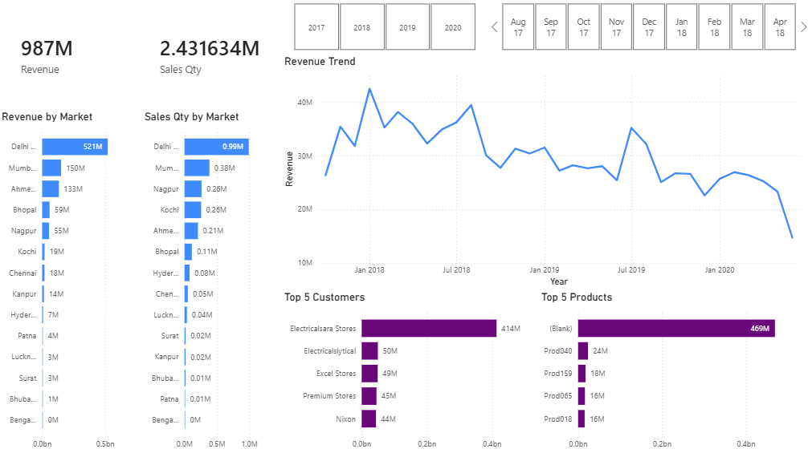

# Sales insights and revenue reconciliation

How much hardware did AtliQ sell in 2019, which market contributed the most, and can the underlying transactions reproduce the dashboard? This Power BI coursework uses the MySQL sales snapshot distributed in [Codebasics' Sales Insights project](https://github.com/codebasics/DataAnalysisProjects/tree/master/1_SalesInsights). It covers 4 October 2017 to 26 June 2020. The bundled dump matches the upstream file byte for byte.

[Open the saved Power BI report](Sales_Project.pbix) · [Inspect the SQL checks](sales_checks.sql) · [Corrected Power Query](transactions.pq)



## What the 2019 report shows

| Metric | Reconciled result |
|---|---:|
| Included transaction rows | 51,817 |
| Sales quantity | 847,645 units |
| Revenue | INR 336,452,114 |
| Delhi NCR revenue | INR 171,754,629 |

Delhi NCR contributed roughly 51% of 2019 revenue. Product rankings need more care: **18,387 included transaction rows** refer to **55 product codes** missing from the product dimension. Those rows represent INR 154,613,207 in the fact total. A blank product group can therefore hold substantial revenue. Joining to the product dimension with an inner join would hide it.

## Why two revenue totals appear in the checks

The saved report excludes sales amounts of 0 and −1, leaving 148,672 of 150,283 raw rows across all years. Its currency rule multiplies USD amounts by 75 only when the code ends with a carriage return. In November 2017, two included rows contain plain `USD`, with source amounts of 500 and 250. The report counts them at face value.

| Period | Saved report | After normalizing the currency codes |
|---|---:|---:|
| 2017 | 93,624,652 | INR 93,680,152 |
| 2019 | 336,452,114 | INR 336,452,114 |
| All dates in snapshot | 986,621,268 | INR 986,676,768 |

Trimming the currency codes and applying the same exercise rate to every USD row increases the all-period figure by **INR 55,500**. The 75 INR/USD factor comes from the original Power Query. A dated FX rate table would be needed to value transactions at historical market rates. Two other rows have the same business fields as the plain USD rows and a different currency spelling. There is no reliable transaction ID for deciding whether they are duplicate sales, so both calculations retain the source rows.

## Reproduce the comparison

1. Use a disposable local MySQL 8 instance. The supplied dump selects a database named `sales` and drops and recreates tables there. From this directory, run the following in the MySQL client.

   ```sql
   SOURCE db_dump.sql;
   USE sales;
   SOURCE sales_checks.sql;
   ```

2. The checks return the source inventory, currency spellings, annual totals, 2019 market ranking and unmatched products. The annual comparison returns a null corrected total for a period containing unknown currency codes. All included rows in this snapshot map to INR or USD.
3. Open the PBIX to explore the saved model. To refresh against the restored database, configure the MySQL connection in Power BI Desktop for `localhost` and database `sales`, using your local credentials.
4. To test the normalization in Power BI, open a copy of the PBIX. In **Transform data**, select **sales transactions**, open **Advanced Editor**, paste [transactions.pq](transactions.pq), then select **Close & Apply**. Compare the 2017 and 2019 totals above. The downloadable PBIX and preview show the original calculation.

The SQL checks were executed on a local MariaDB 11.8 test instance against the dump data. The saved PBIX query and cached model were inspected independently. The Power Query replacement still needs a refresh in Power BI Desktop to verify the Windows connector path.
